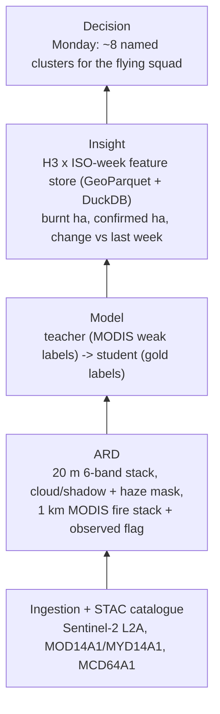
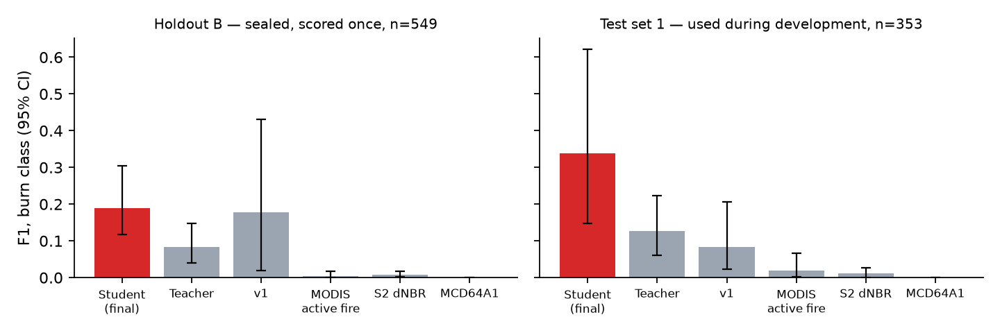

# ParaliWatch

A weekly, refreshable now-cast that tells a district officer which village clusters in the Ludhiana–Patiala belt burnt paddy residue (parali) this week, how much, and how sure we are.

| Code | Value |
|------|-------|
| Reference number | 123456 (n = 3456) |
| Region | **R1** Punjab, Ludhiana–Patiala belt |
| Primary sensor | **S4** MODIS |
| Domain | **D5** Burn scars |
| Task | **T4** Multi-sensor fusion (Sentinel-2 x MODIS) |

`uv run paraliwatch codes 123456` reproduces this table from the reference number.

## Use-case

**User:** the district nodal officer / PPCB field coordinator for the Nabha–Amloh–Fatehgarh Sahib–Patiala belt, during the Oct–Nov paddy-residue burning season.

**Decision, every Monday:** which ~8 village clusters get the flying squad and the awareness / CRM-machinery visits this week.

**Product:** a recurring weekly now-cast. The useful output is a ranked, named list of clusters with newly burnt hectares and the change versus last week, each with an honest evidence flag:

| Flag | Meaning |
|------|---------|
| MODIS-confirmed | Sentinel-2 mapped the burn and a MODIS active fire fell in the same 1 km cell and interval |
| Sentinel-2-only | Sentinel-2 mapped the burn, MODIS saw no fire |
| MODIS-only | MODIS saw fire but Sentinel-2 was blind (smog or cloud), so area is unknown |

## Design: backwards from the decision



Each stage is justified by the one above it; see [docs/ARCHITECTURE.md](docs/ARCHITECTURE.md).

## Quickstart

Requires [uv](https://docs.astral.sh/uv/) and network access to Planetary Computer.

```bash
make run        # or: uv run paraliwatch run
make serve      # then open http://localhost:8000
```

- `make run` installs the pinned environment, then runs ingest, ARD, fusion, features, evaluation and the dashboard build.
- The pipeline is **idempotent**. `make refresh` is the same command: every stage only processes scenes the STAC catalogue has not seen (or whose parameters changed).
- Cold run: about 20 minutes, dominated by Sentinel-2 COG reads. Warm run (no new scenes): about 6 minutes, mostly the nested spatial CV of the teacher → student stack.
- `make test` runs the unit tests, `make lint` runs ruff, `make clean` removes derived data and keeps the raw MODIS cache.

## CLI

All commands take `-c/--config` (default `config/punjab_2024.yaml`).

| Command | Purpose |
|---------|---------|
| `codes` | Derive R/S/D/T codes from a reference number |
| `ingest` | Discover new scenes via STAC and register them in the local catalogue |
| `ard` | Build analysis-ready data for catalogued scenes that lack it (`--workers N`) |
| `fuse` | Fit the teacher and student burn models and map burns |
| `features` | Aggregate products into the H3 x week GeoParquet feature store |
| `evaluate` | Score the map and baselines against every photo-interpreted reference set (test set 1, holdout B) |
| `label-page DIR` | Write a self-contained labelling page for a sample set (e.g. `reference/testB`) |
| `asset` | Render the static dashboard into `site/` |
| `run` | `ingest` -> `ard` -> `fuse` -> `features` -> `evaluate` -> `asset` |
| `places` | Refresh the OpenStreetMap place-name snapshot |
| `query "SQL"` | Run SQL over the feature store (tables `hex_week`, `hex_season`) |

### Example query

`make query` answers the weekly question in SQL, comparing the fused map with the MCD64A1 baseline:

```sql
SELECT week, round(sum(burnt_ha)) AS burnt_ha,
       round(sum(burnt_ha_confirmed)) AS confirmed_ha,
       round(sum(mcd64_ha)) AS mcd64_ha
FROM hex_week GROUP BY week ORDER BY week
```

## Repository layout

```
config/punjab_2024.yaml   one file = one season over one AOI
src/paraliwatch/
  cli.py                  Typer entry point
  config.py               settings + code derivation
  grid.py                 canonical 20 m grid, 1 km MODIS grid
  ingest.py               STAC discovery -> catalogue
  catalog.py              local STAC catalogue, lineage, params hash
  ard.py                  analysis-ready Sentinel-2 and MODIS
  fusion.py               teacher -> student Sentinel-2 x MODIS burn model
  objects.py              field segmentation / voting (tried, disabled)
  features.py             H3 x week feature store, DuckDB views
  evaluate.py             design-based accuracy assessment
  asset.py                static dashboard builder
  places.py               OSM place names
reference/places.geojson  OSM snapshot (ODbL)
reference/                test set 1 sample, chips and labels; train_chips*/ and train_labels_*.csv
reference/testB/          holdout B: sample, chips, labels_A/B/C, label.html
site/                     generated dashboard (index.html)
tests/                    unit tests
docs/                     ARCHITECTURE, MODEL_CARD, REPORT, AI_LOG
data/                     generated: raw cache, ard, products, features, catalog
```

## Data sources

| Source | Collection / product | Use |
|--------|----------------------|-----|
| Planetary Computer STAC | `sentinel-2-l2a`, MGRS tile 43RFP | 20 m NIR/SWIR/visible burn detection and haze mask |
| Planetary Computer STAC | `modis-14A1-061` (MOD14A1 + MYD14A1) | 1 km daily active-fire mask, training signal and evidence flag |
| Planetary Computer STAC | `modis-64A1-061` (MCD64A1) | 500 m monthly burned area, baseline only |
| OpenStreetMap (Overpass), ODbL | `reference/places.geojson` | village and town names for the dispatch list |

## Documentation

- [docs/ARCHITECTURE.md](docs/ARCHITECTURE.md): design choices and why
- [docs/MODEL_CARD.md](docs/MODEL_CARD.md): model, labels, limits
- [docs/REPORT.pdf](docs/REPORT.pdf): short report
- [docs/AI_LOG.md](docs/AI_LOG.md): AI-tool usage log

## Results

**Season total (2024-09-20 to 2024-11-30), v3 model:** 9,722 ha mapped burnt in the AOI, 9.2% MODIS-confirmed (v1 mapped 18,133 ha; it counted smog haze and tillage as burns). Late-season Sentinel-2-only area (W47–W48, about 1,300 ha/week) falls in the interval where holdout B accuracy is weakest (F1 0.08), so it is likely inflated by tilled or emerging-wheat fields; treat late-season area as an upper bound.

**Headline: holdout B.** 552 points on three new intervals (2024-10-13→10-23, 10-30→11-07, 11-19→11-29), drawn from the v2 maps and sealed before any further model development, in 1 km cells disjoint from every training and earlier test point; scored once, on the final v3 model. Stratum-weighted F1, estimate [95% CI]:

| Map | Adjudicated (549 pts, 67 burns) | Unanimous A=B only (394 pts, 24 burns) |
|-----|---------------------------------|----------------------------------------|
| **v3 student (this work)** | **0.190** [0.117, 0.306] | **0.378** [0.234, 0.506] |
| teacher | 0.084 [0.040, 0.151] | 0.116 |
| v1 | 0.178 [0.021, 0.425] | 0.015 |
| MODIS active fire | 0.005 | |
| Sentinel-2 dNBR | 0.008 | |
| MCD64A1 | 0.0 | |

Adjudicated student: precision 0.272 [0.169, 0.403], recall 0.146 [0.082, 0.299]; unanimous subset precision 0.26, recall 0.72. Resolving every dispute as interpreter A gives 0.374, as B 0.215, so the defensible statement is a bracket of roughly 0.19–0.38. Interpreter agreement was low (κ 0.55, vs 0.87 on test set 1): in late November A read dull grey-green tilled patches as emerging wheat and B as char, and the adjudicator called burns on 28% of disputed points vs 6% of unanimous ones. By interval (adjudicated): early 0.32, peak 0.18, late November 0.08. Errors are mostly omission, concentrated in the "other change" stratum.

**Development set (test set 1).** 360 points on two earlier intervals; it was scored four times during development (v3 student F1 0.339 [0.149, 0.624], unanimous 0.427; v2 had 0.280). It is no longer clean and is not the headline. The drop from 0.34 to 0.19 is the expected price of reuse plus harder new intervals.

Overall accuracy on holdout B is about 0.98 for the student, teacher, v1 and MCD64A1, which maps nothing. It reflects the unburnt majority and is not informative.

F1 0.9 is not supported. On a clean holdout the student is 0.19 (adjudicated) to 0.38 (unanimous), about 2x the teacher and far above the MODIS products and dNBR; v1 is comparable on adjudicated holdout B but with a much wider interval, and collapses on the unanimous subset. The binding constraint is training and reference label quality: all labels come from AI interpreters on 20 m chips, not field data. `paraliwatch label-page reference/testB` writes a labelling page so a human can replace any interpreter. Use as a triage aid, not as enforcement evidence. Details: [docs/REPORT.pdf](docs/REPORT.pdf) and [docs/MODEL_CARD.md](docs/MODEL_CARD.md).





**Deployment:** `.github/workflows/refresh.yml` re-runs the pipeline on a schedule and publishes `site/` to GitHub Pages.
