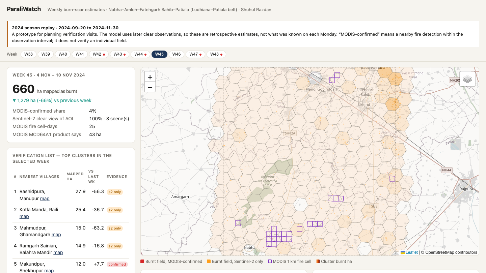
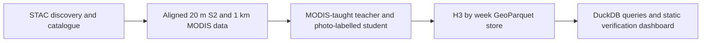
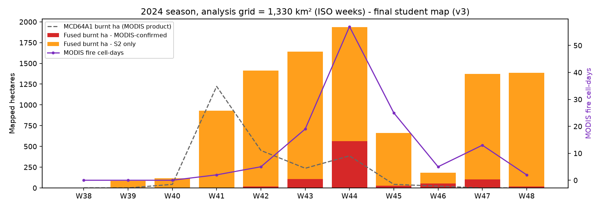

# ParaliWatch

Weekly burn-scar estimates for the Ludhiana-Patiala belt, built with MODIS and Sentinel-2. The dashboard ranks village clusters where a district field coordinator could send teams to check suspected paddy-residue burning.

**Shuhul Razdan · EO-AI Labs, Role 01 assignment**

This submission replays **20 September-30 November 2024**. It is a working historical prototype: the student model uses the next clear observation to distinguish persistent char from temporary darkening, so its weekly maps are retrospective. They do not show what an officer would have known on each Monday.

## Try the dashboard

```bash
git clone https://github.com/shuhulx/parali-watch.git
cd parali-watch
make demo
```

Open [localhost:8000](http://localhost:8000). The committed dashboard and overlays are ready to view; this route only needs Python 3. Select a week, inspect the mapped hectares and evidence flags, then click a village cluster to zoom. Map tiles, Leaflet and Chart.js need internet access. The repository is private, so cloning requires access.



## The decision

The intended user is a district nodal officer or PPCB field coordinator in the Nabha-Amloh-Fatehgarh Sahib-Patiala belt during the October-November paddy harvest. Each Monday, they need a short list of roughly eight village clusters for verification and awareness or crop-residue-management visits. Useful means a named, ranked list, a weekly area estimate, and a clear indication of where the sensors disagree or cannot see the ground. The current asset demonstrates that workflow on 2024 data; operational use needs human validation and an evaluation with a strict information cutoff.

| Evidence flag | What it means |
|---|---|
| MODIS-confirmed | Sentinel-2 mapped a suspected scar and MODIS detected fire nearby within the same observation interval. This is coarse corroboration, not field-level confirmation. |
| Sentinel-2-only | A suspected scar without a matching MODIS fire. Short fires can be missed by MODIS; tillage can also resemble char. |
| MODIS-only blind spot | MODIS detected fire where Sentinel-2 had little clear coverage. The blind-spot card reports fire cell-days, not burnt hectares. |

## Assignment configuration

| Item | Value used in this repository |
|---|---|
| Working reference | 123456; last four digits 3456 |
| Region | R1 - Punjab, Ludhiana-Patiala belt |
| Primary sensor | S4 - MODIS |
| Domain | D5 - Burn scars / fire-affected area |
| Task | T4 - Multi-sensor fusion |

`uv run --frozen paraliwatch codes 123456` reproduces the codes from the chosen reference, under the instructor's email permission to choose any number. Changing just this number does not adapt the AOI, sensors or model to another assignment.

## Reproduce the pipeline

Install [uv](https://docs.astral.sh/uv/), then run:

```bash
make run        # locked environment; ingest -> ARD -> fuse -> features -> evaluate -> asset
make query      # weekly hectares and MODIS baseline from the GeoParquet store
make serve      # http://localhost:8000
```

The Python version is in `.python-version`; `uv.lock` pins the dependencies and the Makefile uses `--frozen`. Data comes from the public Planetary Computer STAC API; no Earth Engine account or API key is needed. Allow roughly 20-30 minutes for a cold run, depending on network and CPU. Earlier warm runs took about six minutes. Ingestion and ARD reuse current catalogue entries; fusion refits and the feature store, evaluation and dashboard rebuild on every run. `make refresh` reruns the configured 2024 window; it does not advance to today's date.

```bash
make test       # unit tests
make lint       # ruff
make clean      # remove derived data; keep raw MODIS and grid caches
```

The frozen sample and label CSVs under `reference/` are inputs. Keep them when reproducing the reported evaluation. A failed scene build stops the run before fusion and preserves completed scenes for retry. Evaluation requires the final and teacher prediction rasters; it also exports the unanimous-reference comparison separately. A cold run cannot reproduce the retired v1 map, which is not committed; unavailable baselines are identified in the evaluation. Reported v1 results are historical, not an output promised by `make run`.

## From data to decision



MODIS supplies weak training labels, fire features and approximate timing. Sentinel-2 supplies the finer spatial detail. Scene and product STAC items record lineage and parameter hashes. H3 resolution-8 features roll up to resolution 7 for the cluster list.

| Source | Product | Purpose |
|---|---|---|
| Planetary Computer | `sentinel-2-l2a`, tile 43RFP | NIR, SWIR and visible bands at 20 m; cloud, shadow and haze masking |
| Planetary Computer | `modis-14A1-061` | Terra/Aqua daily 1 km fire masks; weak supervision and timing |
| Planetary Computer | `modis-64A1-061` | Monthly 500 m burned-area baseline |
| OpenStreetMap | Committed `reference/places.geojson`, ODbL | Nearest village names; these are not village boundaries |

## What the results support

Across the **1,330 km² snapped analysis grid** (including padding around the requested box), the v3 map contains **9,721.8 ha** classified as burnt, with **9.2%** corroborated by MODIS. This is mapped area, not a validated estimate of actual seasonal burnt area. Late-November estimates are particularly uncertain because tillage and emerging wheat can resemble burn scars.

The main evaluation is **holdout B**: 552 sampled points on three intervals, with 549 usable adjudicated labels. Its 1 km cells were excluded from training and earlier test sets. All reference labels were made by AI vision interpreters, not field teams.

| Method | Precision | Recall | F1 [95% bootstrap interval] |
|---|---:|---:|---:|
| Student | 0.272 | 0.146 | **0.190 [0.117, 0.306]** |
| Teacher | 0.109 | 0.068 | 0.084 [0.040, 0.151] |
| Sentinel-2 dNBR | 0.006 | 0.016 | 0.008 |
| MODIS active fire | 0.005 | 0.006 | 0.005 |
| MCD64A1 | 0 | 0 | 0 |

On the easier unanimous-label subset, student F1 is 0.378 [0.239, 0.510]. That is a different reference cohort, not an upper confidence bound on the headline. Interpreter agreement is modest (kappa 0.55), and late-November F1 is 0.08. The earlier test set was reused during development and is labelled as a development set. Overall accuracy is about 98% even for methods that map no burns, so it is not a useful headline.

These results support further testing as a verification aid. They do not support enforcement against individual farmers. Human reference labels, a stronger late-season classifier and an evaluation limited to observations available at each decision date are needed before operational use.



## Files and commands

| Location | Contents |
|---|---|
| `config/punjab_2024.yaml` | AOI, dates, source collections and model settings |
| `src/paraliwatch/` | Ingestion, catalogue, ARD, fusion, features, evaluation and asset builder |
| `reference/` | Frozen samples, AI labels, chips and place names |
| `data/` | Generated cache, catalogue, ARD, model and GeoParquet store; gitignored |
| `site/` | Committed dashboard and weekly PNG overlays |
| `docs/REPORT.pdf` | Four-page submission report; source: `docs/REPORT.html` |
| `docs/MODEL_CARD.md` | Inputs, method, evaluation history and failure modes |
| `docs/ARCHITECTURE.md` | Engineering decisions and implementation details |
| `docs/AI_LOG.md` | Assistant use and contribution disclosure |

Run `uv run --frozen paraliwatch --help` for the stage commands. Each pipeline stage accepts `-c/--config`; `make run CONFIG=...` and `make query CONFIG=...` pass it through. `paraliwatch label-page reference/testB` rebuilds the human labelling desk from ARD. `paraliwatch places` refreshes the OpenStreetMap snapshot.

`.github/workflows/ci.yml` runs tests and lint. The manual `publish-demo` workflow can publish the committed snapshot to GitHub Pages, or rebuild the fixed season first. Pages must be enabled and available for the repository's visibility and account plan. No hosted URL is claimed here; the documented local route is the submission asset.
