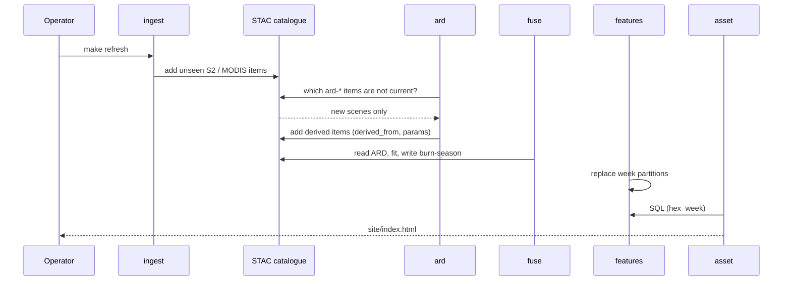
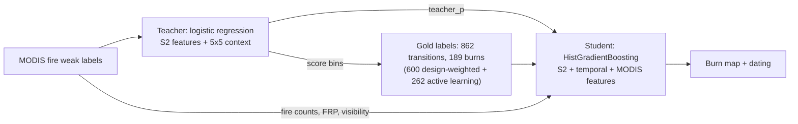

# Architecture

Backwards design: the Monday dispatch list (decision) needs a weekly per-cluster burnt-area table (insight), which needs a per-pixel burn map (model), which needs aligned, masked imagery (ARD), which needs a catalogue that knows what has been seen (ingestion). Each section below is one choice and its reason.

Pipeline: `ingest -> ard -> fuse -> features -> evaluate -> asset` (`cli.py:run`).

## (a) STAC catalogue as the single source of truth

`catalog.py:LocalCatalog` stores every remote scene seen and every file made as a STAC Item, in six collections (`COLLECTIONS`). Derived items carry `derived_from` links to their inputs and a `paraliwatch:params` hash (`params_hash`, `add_derived`).

- **Idempotent refresh.** `is_current` is true only if the hash matches and every asset file exists. `ard.py:run` builds only scenes where it is false.
- **Invalidation.** Changing a parameter changes the hash, so exactly the products it touches are rebuilt.
- **Lineage.** Any burn pixel traces back to scene IDs.
- `ingest.py:discover` stores metadata only. Pixels are fetched later. Ingestion and ARD reuse current scenes; downstream stages still rebuild.

## (b) One canonical grid

`grid.py:Grid` snaps the AOI to a 20 m UTM 43N lattice whose extent is a multiple of 50 cells, so the MODIS grid is an exact 50x coarsening (asserted in `__init__`). A pixel's MODIS cell is `(row // 50, col // 50)` (`fusion.py:coarse_cell`), and `Grid.upsample` broadcasts 1 km arrays by repetition. No per-pixel lookups, no resampling drift between sensors.

## (c) Sentinel-2 masking for burn scars

`ard.py:s2_valid_mask`. Sen2Cor often labels fresh burn scars as dark area (SCL 2) or cloud shadow (SCL 3). Dark area is kept. Shadow is kept unless a cloud lies within 1.5 km (`SHADOW_CASTER_M`), because a shadow needs a caster. Tested in `tests/test_ard.py`.

- Six bands are stored (`S2_BANDS`): B8A, B11, B12 (NIR/SWIR, which separate char from stubble) and B02, B03, B04 (visible, needed for the haze test and the student's HOT features).
- **Haze mask (ARD v2).** Sen2Cor SCL does not flag Oct–Nov smog. Pixels with the Haze-Optimised Transform `HOT = B02 − 0.5·B04 > 0.06` (`HAZE_HOT_MAX`) are invalid. Clear scenes lose 1–2% of pixels; the smog scenes of Nov 9 and 12 lose 30–46%. This removed a fake week-47 "burn spike" (6,424 ha → 1,095 ha). The change bumped the ARD version, which invalidated the catalogue and rebuilt all 27 scenes with no manual step (see (a)).
- `_boa_offset` subtracts the +1000 offset for processing baseline >= 04.00.
- Invalid pixels are 0 in every band; ARD is written to a tiled, deflate GeoTIFF via a `.part` file then renamed.

## (d) MODIS "observed" flag

`ard.py:build_fire_stack` keeps the max FireMask class across Terra and Aqua per day and an `observed` array (classes in `FIRE_OBSERVED`: water, land, fire). Cloud and missing cells are not observed. `fusion.py:weak_labels` only makes a negative when the cell was observed, so no fire under cloud is never evidence of no burning (`tests/test_fusion.py::test_no_fire_under_cloud_is_not_a_negative`).

## (e) Fusion

`fusion.py` moves the MCD64A1 idea (active fires train a burn-sensitive change classifier) from 500 m to 20 m.

1. `fold` streams scenes in date order, keeping each pixel's last clear observation. Each clear-to-clear transition with an NBR drop above `change_min_dnbr` **or** a SWIR-1 darkening above `change_min_dswir` is a candidate. Memory is one previous scene plus transitions; a new scene adds one step.
2. `weak_labels`: positive = MODIS fire in the pixel's own cell during the interval; negative = no fire within +/-2 cells and +/-2 days, and the cell was observed; else unlabelled.
3. `fit`: balanced logistic regression on Sentinel-2 features only (`FEATURES`, now including 5×5 local context). This is the *teacher*; section (k) adds the student that produces the final map. MODIS is kept out of the features so the model cannot read its own label. Validation is spatial `GroupKFold` over 1 km cells, so pixels from the same 1 km cell never straddle train and test; adjacent cells may still be neighbours.
4. The first transition over threshold (teacher: Neyman–Pearson; final: student threshold, see (k)) is the pixel's burn, reported in the week Sentinel-2 observed it. Evidence is `2` MODIS-confirmed, `1` S2-only, +10 if the gap exceeds `max_gap_days`.
5. `FireIndex` holds cumulative sums over days (`_cum`), so "any fire in cell c between days a and b" is two array reads, O(1) per transition.

Labels are noisy by construction (a burning 1 km cell also holds unburnt fields). The honest check is `evaluate.py`, not the weak-label AUC.

## (f) H3 feature store

`features.py`.

- **H3 res 8** (~0.74 km2, roughly a village's fields) is the join key. `hex_index` assigns each pixel to a hex once (cached in `data/cache`); every 20 m, 500 m and 1 km layer then aggregates with `bincount`.
- **Exact roll-up to res 7** via `h3.cell_to_parent`, used for the dispatch list. Columns are additive (hectares, fire cell-days), so sums at res 7 are exact.
- **GeoParquet, hive-partitioned by ISO week** (`week=2024-W43/`). A refresh rewrites only the weeks it computes.
- **Partition replacement.** Each week is written to `.tmp-<week>`, then the old partition is removed and the new one renamed. This avoids partial files but has a brief missing-partition window; concurrent readers are not supported.
- **DuckDB views** `hex_week` and `hex_season` (`connect`) make the data queryable with `paraliwatch query`.
- `s2_seen_frac` and `s2_clear_scenes` are stored so the dashboard can say how much of a hex Sentinel-2 actually saw.

## (g) Evaluation

`evaluate.py` follows Olofsson et al. (2014). Strata from the student map (mapped burn / teacher-only burn / other change / stable) are sampled in fixed counts (`n_per_stratum`: 70/50/40/20) on two intervals, one at peak burning and one spanning the 9–17 Nov smog gap. `make_sample` shuffles the points; `render_chips` shows pre/post SWIR chips with no stratum or model output. Two interpreters label independently and `kappa` reports their agreement (0.866). A blind third interpreter adjudicates disputed or unclear points; `ref_source` in `reference/scored_points.csv` records `A=B` (unanimous) or `C` (adjudicated), and `evaluate.py` reports both variants. Test points sit in cells excluded from training. `_estimate` gives stratum-weighted precision, recall, F1 and burnt proportion with bootstrap CIs, for the student, teacher, v1 and the baselines on the same points. `evaluate.run` scores every reference set through `score(ref)`; `evaluation.json` holds test set 1 at the top level and holdout B under `holdout_b`, and the dashboard trust panel shows holdout B.

- **Test set 1 is now a development set.** It was scored four times during development, so it no longer measures generalisation.
- **Holdout B** (`reference/testB/`) is the headline. It was drawn once from the v2 maps and sealed before any further model development, then scored once on the final model: 552 points on three new intervals (early, peak, late season), 60/40/60/24 per interval with "other change" over-allocated because missed burns there dominate the recall interval. Its 1 km cells are disjoint from every training point and earlier test set; strata and population counts are frozen in `sample.csv`, seed and date in `sample_meta.json`. Sealed cells (test set 1 + holdout B: 570 of 1,330 km cells) are excluded from teacher weak labels, gold labels, pseudo-labels and active-learning sampling; holdout-B locations feed only these exclusion masks (a Codex verification found no overlap with any training or earlier test cell). "Scored once" is enforced: `reference/testB/scoring_receipt.json` holds the fingerprint of the model that first scored it, and a later evaluation with a different model drops the claim (the dashboard then says "re-scored").
- **Label desk.** `paraliwatch label-page DIR` (`evaluate.render_label_page`) writes a self-contained `label.html`: the same four chips per point at native 20 m pixels, keys 1/0/9, notes, browser autosave, export to `labels_<name>.csv` in the pipeline's format. A human set slots in as interpreter A, B or C; no model output is embedded.

## (h) Static dashboard

`asset.py:build` renders one `site/index.html` from SQL over the feature store, with weekly PNG overlays and MODIS cells for the scale contrast. A browser loads the generated HTML and PNG overlays; no server to keep alive; hostable on any static host. `_evidence` assigns confirmed / s2-only / modis-only / none per cluster.

## Re-running the configured season

The supplied configuration is fixed to September-November 2024. The GitHub workflow is manual and can publish the committed demo without retraining. It does not provide a live weekly service. The student uses a later clear view for char-persistence features, so earlier weeks can change as scenes arrive. A live version needs a strict information cutoff and a separate temporal evaluation.

Cost: ingest and ARD are O(new scenes). Fusion re-reads the compact ARD files and refits, features rewrites every week partition, evaluation and the asset rebuild. With no new scenes a warm run takes about 5 min, mostly the nested spatial CV (the teacher is refit inside every fold).

## (i) What I would do for production

- **VIIRS 375 m active fire** (VNP14IMG). A finer active-fire signal is worth testing for small fields.
- **Sentinel-1** SAR for smog weeks when Sentinel-2 is blind.
- **Field-boundary polygons** so detections aggregate to fields, not hexes. A first attempt (pixel voting over segments, `objects.py`) failed, see (k).
- **More and human-made labels**, the binding constraint on accuracy (the label desk exists for this).
- **Scheduled refresh**: cron or a GitHub Action running `make refresh` and publishing `site/`.
- **Postgres / pgSTAC** for the catalogue and PostGIS or a lakehouse for features, once there is more than one user or AOI.
- Incremental fusion (persist transitions per scene instead of refolding) if the season grows beyond a few dozen scenes.

## (j) The fusion is three roles, not one model

The distinctive part of the design is that the two sensors do different jobs instead of being stacked as features:

| Role | Sensor that leads | Where |
|---|---|---|
| **Teacher.** MODIS active fires weakly label which Sentinel-2 transitions are fires (MCD64A1 idea at 20 m; MODIS kept out of the teacher's features so it cannot leak its own label). | MODIS → S2 | `fusion.weak_labels`, `fusion.fit` |
| **Clock.** S2 says *which field*; MODIS says *when*. A confirmed burn is re-dated to the last MODIS fire inside its S2 interval, so burns hidden by the Nov smog do not pile up on the first clear day. | MODIS | `FireIndex.last_near_day` |
| **Gap-filler.** Where MODIS sees fire but S2 saw no clear ground that week, the *blind-spot* score (fire cell-days on unseen pixels, additive under H3 roll-up) gets its own dispatch card. An optical-only map would silently report zero there. | MODIS | `features.run` (`blind_spot`), dashboard card |

MODIS also re-enters in v2 as student *features* (see (k)). The teacher's threshold is Neyman–Pearson (cap false alarms on MODIS-quiet changes at 5%), because weak labels make P uncalibrated: a 0.5 cut-off mapped ~80% of the AOI as burnt.

## (k) Teacher → student, label-efficient fusion (v2, extended in v3)

`fusion.py`. v1's single weak-label model was good at ranking but its boundary mixed tillage and burns. v2 keeps it as a *teacher* and adds a *student* trained on a few hundred photo-interpreted labels.

1. **Candidates.** NBR drop > 0.10 or SWIR-1 darkening > 0.06, because stubble → char barely moves NBR. An endpoint-change diagnostic on the test set compares interval endpoints; it is not a recall ceiling, because fusion gates consecutive clear views.
2. **Teacher.** As in (e), plus 5×5 local-context features. Spatial-CV AUC against weak labels 0.746. Outputs `burn_season_teacher.tif`.
3. **Gold labels.** Transitions drawn stratified over teacher-score bins, photo-interpreted by AI vision models: 222 (round 1) + 282 (round 2, haze-free scene pairs only) + 96 recycled from a retired test set = 600 probability-sampled labels; round 3 (v3) adds 262 active-learning labels (`fusion.active_sample`: 240 transitions closest to the student threshold in logit space, at most one per 1 km cell, plus 80 random mapped-burn audits). Total 862, 189 burns. A recycled label maps to a transition only when exactly one transition lies wholly inside the labelled interval. Labels match transitions on the exact (pixel, pre, post) triple. Any label in a 1 km cell holding a sealed test point (test set 1 or holdout B) is dropped, and MODIS weak labels from sealed cells are excluded from fitting the teacher and its threshold.
4. **Student.** `HistGradientBoosting` on S2 features, temporal features (`b12_next`, `nbr_next`, `next_gap`: char persistence in the next clear view; `hot_pre`, `hot_post`) and MODIS features (`modis_own`, `modis_near`, `modis_high`, `modis_frp_max`, `modis_seen_frac`, `teacher_p`). MODIS can be a feature now because the labels no longer derive from it.
5. **Threshold and CV.** Each label gets a design weight (teacher-score bin share ÷ labels in that bin); the threshold maximises population-weighted F1. Validation is spatially nested: 3 km blocks, teacher refit inside each fold. Active-learning rows are not a probability sample, so they train outside each held-out spatial block but are never scored (`scored` mask in `_student`, design weight 0): OOF F1, threshold and the self-training gate use the 600 scored labels. Because the AL batch was chosen by a model fit on all labels and the threshold maximises the reported OOF F1, the CV figure is mildly optimistic; holdout B is the held-out estimate against AI-interpreted reference labels. If a run dies after round-3 sampling, the trigger re-renders the chips. Student AUC 0.899, population-weighted F1 0.592, threshold 0.25 (v2: 0.559 / 0.23; before active learning 0.573). Design weights are a teacher-score-bin approximation across cohorts with different sampling designs (known approximation).
6. **Self-training.** Up to 500 pseudo-labels per class at weight 0.1 (teacher-confident, MODIS-consistent). The pool is excluded at 1 km-cell level (gold and sealed cells), not 3 km blocks, because the sealed sets now touch all 156 blocks. In nested CV pseudo-labels are dropped from held-out blocks, re-derived per fold with the fold teacher and kept only where it agrees. `fusion.py` adopts it only on a real CV gain. v2 adopted it (0.548 → 0.559); in v3 it lost (510 pseudo-labels, 0.581 < 0.592), so it is rejected.
7. **Outputs.** `burn_season_pixel.tif` is the student map; `burn_season.tif` is the same file while `field_voting` is false.

**Tried and rejected.** *Field-object voting* (`objects.py`, written by Codex): segments are about 50 px but burn pixels cover about 5% of a segment, so voting erased scars; disabled in config. *Char-albedo gate* (v1): no gain on the held-out interval.

**External review.** Codex (model `gpt-6-astra`) reviewed the pipeline. The recommendations and outcomes are recorded below; stable-stratum expansion remains future evaluation work:

| # | Recommendation | Status |
|---|----------------|--------|
| 1 | More gold labels | done (round 2, recycled set); stable strata not enlarged, see below |
| 2 | Exact transition matching | done |
| 3 | Population-weighted threshold | done |
| 4 | Nested teacher + student CV | done |
| 5 | Measure candidate recall | done as an endpoint-change diagnostic (not a recall ceiling) |
| 6 | Temporal and haze features | done |
| 7 | Local context instead of voting | done |
| 8 | MODIS confidence and FRP | done |
| 9 | Blind third-interpreter adjudication | done (C, 63 of 70 resolved) |
| 10 | Deferred, then trialled, self-training | done (adopted in v2; rejected by the same gate in v3) |

Not done: enlarging the stable strata. The stratification map that recommendation referred to had already been superseded.

**Result.** Holdout B (sealed, scored once) F1 0.190 [0.117, 0.306] adjudicated, 0.378 [0.234, 0.506] unanimous, dispute-sensitivity estimates 0.215 and 0.374; teacher 0.084, v1 0.178 (0.015 unanimous). Interpreter κ was 0.55, so the adjudicator moves the headline. On the development set (test set 1, scored four times) v3 reaches 0.339. The adjudicated holdout F1 is 0.190; the binding constraint is label quality. Late-season Sentinel-2-only area coincides with the weakest interval (late November, F1 0.08) and may be inflated. See `docs/MODEL_CARD.md`.
